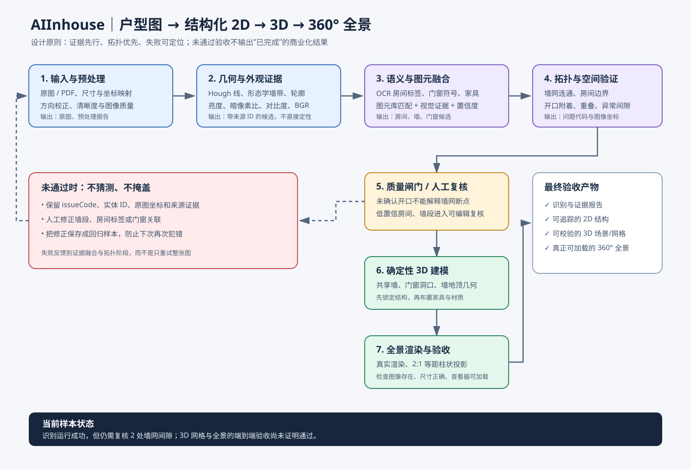
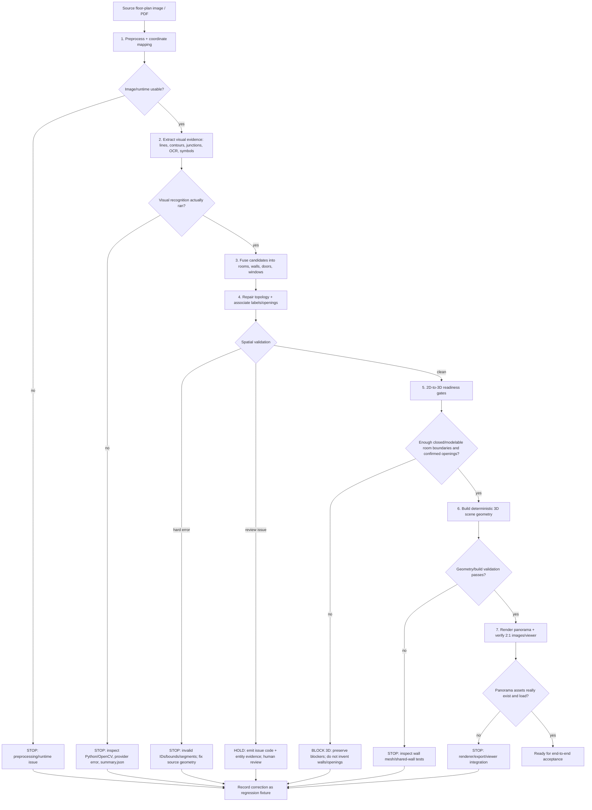

# Floor-plan AI pipeline: accuracy first, cost-aware by default

## Why a single expensive vision call is not enough

A strong multimodal model can interpret symbols and spatial context, but it should not be treated as a CAD engine or a source of exact measurements. Keep visual interpretation, geometry extraction, validation, and rendering as separate responsibilities.

## Visual design diagram

## Recommended pipeline

1. **Normalize the source**: preserve the original image; deskew, denoise, improve contrast, and retain a mapping from processed pixels back to source coordinates. For PDFs, extract the embedded text layer before OCR.
2. **Local geometry pass**: use OpenCV line/contour/morphology candidates and the existing wall/door/window detectors. This pass is cheap and deterministic; it supplies candidate geometry rather than final truth.
3. **One multimodal semantic pass**: send the original image plus focused high-resolution crops for small labels/symbols only when available. Ask for strict structured JSON with room labels, evidence, confidence, and unresolved ambiguities. Do not ask the model to invent precise dimensions.
4. **Deterministic fusion**: match labels only to regions that contain their centers; use wall topology and symbol evidence to reconcile room boundaries. Preserve special spaces such as elevator shafts, pipe shafts, equipment platforms, entry foyers, and balconies as first-class types.
5. **Geometry validation**: check wall intersections, room overlap, impossible areas, opening-to-wall alignment, room connectivity, duplicate labels, scale consistency, and bounds. Use code for arithmetic and constraints.
6. **Conditional recovery pass**: call the more capable/expensive model only when quality gates fail or when high-impact conflicts remain. Send the smallest relevant crops and a short list of specific conflicts, not the whole prompt/context again.
7. **Human correction**: present low-confidence walls, openings, and room types as editable overlays. Save corrections as structured ground truth for regression tests and future model tuning.
8. **3D and panorama**: compile the corrected geometry into a deterministic scene graph first. Add furniture/materials after topology is locked. Render genuine equirectangular panoramas from the 3D scene, then create Pannellum scenes/hotspots; never treat a generated configuration or a flat preview as proof that a 360-degree panorama exists.

## Cost controls

- Keep the normal recognition path to one vision-model request; only run a probe/review request after a weak result.
- Cache by image content hash, preprocessing version, prompt/schema version, and model identifier. A path/mtime-only cache can miss duplicate images and does not express prompt/model changes.
- Use low-detail images for plan classification and route uncertain regions to high/original detail only when the provider supports it.
- Crop label-heavy or symbol-heavy regions instead of repeatedly sending the entire high-resolution sheet.
- Keep model choice configurable. Use a cheaper model for classification/semantic extraction and reserve the strongest model for ambiguous/high-value cases.
- Record provider, model, input size, latency, cache hit, retry count, and estimated cost per job; never log API keys or raw private floorplans unnecessarily.

## Quality gates before producing a customer-facing 3D tour

- All high-impact room labels are grounded to visible labels or clearly documented inference.
- Elevator shafts and equipment zones cannot become bathrooms due to nearby OCR.
- Door/window candidates align with wall openings.
- Geometry is connected and room overlaps/intersections are within explicit tolerances.
- Source dimensions and scale assumptions are explicit; inferred dimensions are not presented as exact.
- A valid 3D scene loads; panorama images exist, have 2:1 equirectangular dimensions, and load in the viewer.
- Low-confidence results remain marked as review-required rather than being silently advertised as accurate.

## Evaluation loop

Maintain a fixed set of varied plans (marketing brochures, clean CAD exports, low-resolution scans, plans with elevators/shafts, angled walls, and dense dimensions). Track room recall/precision, label accuracy, wall/opening alignment, topology violations, scale error, end-to-end success, latency, and cost per plan. Every user correction that fixes a structural error should become a regression fixture.

## Debuggable execution flow (source of truth)

Use this flow to locate the *first failed gate*. A green CI means the checks ran and passed; it does **not** mean the sample is already approved for customer-facing 3D.

### Evidence-to-design data flow

This is the implementation contract for the next stages: appearance features stay attached to the line that produced them; they inform ranking and review but never independently declare a line to be a wall.

```mermaid
flowchart LR
  A[Original plan pixels] --> B[OpenCV Hough candidates]
  A --> C[Morphology wall-band candidates]
  B --> D[Raster appearance sampler]
  C --> D
  D --> E[Line evidence: luminance, dark ratio, contrast, BGR, thickness]
  E --> F[Geometry features: endpoints, junctions, parallelism, gaps]
  F --> G[Room / wall / opening candidate fusion]
  G --> H[Topology and spatial validation]
  H -->|hard error or unresolved review| I[Human correction overlay + issue coordinates]
  H -->|all gates pass| J[Deterministic 3D scene]
  J --> K[Mesh and opening validation]
  K --> L[Render actual equirectangular panorama]
  L --> M[2:1 dimensions + viewer-load acceptance]
  I --> N[Ground-truth correction fixture]
  N --> F
```

The sampler records measurable appearance rather than semantic conclusions. In particular, a dark line can still be a dimension line, furniture edge, or annotation; wall classification must continue to combine appearance with geometry, topology, provenance, and symbol evidence.

### Real sample findings that must remain visible

For the checked-in `WX20260329-112615@2x.png` sample (1400×976), the last inspected report found 7 room regions, 29 wall candidates, 25 confirmed openings and 1 proposed opening. The result remained `needs_human_review`; two `wall-network-gap-unexplained` review issues were reported around x=844 and x=1184. The room labels/regions also need a grounded visual audit because the recognized list did not clearly account for every visible named space. These are review findings, not claims of measured model accuracy.

### Stage gates, evidence, and where to debug

| Gate | Required evidence | Failure meaning | First place to inspect |
|---|---|---|---|
| G0 Input/preprocess | Original image retained; dimensions and coordinate mapping; preprocessing report | Image degraded, rotated, cropped, or coordinate transform lost | `scripts/floorplan-preprocess.mjs`, `scripts/batch-recognition-sample.mjs`, generated `recognition-preprocess.json` |
| G1 Runtime | `summary.json` exists and `visualEvidence.visionAvailable === true` | Pipeline silently skipped visual recognition or Python/OpenCV/provider failed | Workflow step “Fail if the real sample silently skips visual recognition”; `summary.json` |
| G2 Evidence extraction | Hough and morphology wall-band candidates retain source IDs, luminance, dark-pixel ratio, local contrast, and mean BGR color | Geometry exists but the image's light/dark/color evidence was dropped before fusion | `scripts/floorplan-preprocess.mjs`, `codex-worker/src/recognizers/geometry-feature-detector.js`, `scripts/inspect-floorplan-geometry.mjs` |
| G3 Semantic fusion | OCR labels assigned only to containing rooms; each candidate retains source evidence | Labels jump rooms or semantic guess is mistaken for observed fact | `codex-worker/src/recognizers/local-draft.js`, `floorplan-grammar.js`, `recognition-assets.json` |
| G4 Topology | Connected wall runs; unexplained gaps surfaced; opening linked to a real wall and evidence | A gap is hidden by an unconfirmed door/window, or opening/room/wall relations are missing | `codex-worker/src/recognizers/topology.js`, `spatial-reasoning.js` |
| G5 Readiness | Modelable room boundaries; adequate geometry proof; confirmed openings; blockers explicitly listed | Recognition may return candidates, but geometry is not safe to extrude into 3D | `scripts/verify-2d-to-3d-readiness.mjs` and readiness report |
| G6 3D geometry | Valid wall meshes, shared-wall behavior, openings cut into walls, no invalid/duplicate geometry | 2D candidates do not compile into reliable geometry | `scripts/blender/aiinhouse_render.py`, `scripts/blender/test_shared_room_walls.py` |
| G7 Panorama | Rendered equirectangular assets with 2:1 aspect ratio and successful viewer load | A scene/config exists but a real panorama is missing or unusable | renderer/export and panorama viewer integration; add an explicit artifact check if absent |
| G8 Acceptance | Fixed real-plan set + regression fixtures; report precision/recall, topology errors, manual-review count | Synthetic unit tests pass but real-world reliability is unproven | sample evaluation report/artifacts and fixed-plan benchmark |

### Diagnostic code meanings

- `wall-network-gap-unexplained`: two nearly collinear wall runs have a gap not supported by a **visually confirmed** opening. Do not suppress it with a proposed/unconfirmed door or window.
- `opening-wall-attachment-missing`: candidate has no explicit wall attachment; it may be near a wall, but proximity is not proof of attachment.
- `opening-wall-attachment-evidence-conflict`: the stored evidence contradicts the claimed wall attachment.
- `door-not-associated-with-room` / `window-not-associated-with-room`: no room association was established; inspect the attached nearest-room and nearest-wall evidence before changing thresholds.
- `room-boundary-review-required`, `insufficient-modelable-room-boundaries`, `low-geometry-proof-ratio`: room candidates exist, but the boundary evidence is not sufficient for deterministic 3D geometry.
- `missing-openings-for-3d` / `proposed-openings-require-review`: proposed openings are not equivalent to confirmed, wall-attached openings; keep the 3D gate closed until evidence or human correction resolves them.

### Current CI reading (run #490, commit `e2309a93c756b8fc05f6ad8342677551b67dafe3`)

- **Passed:** `npm run verify:2d3d`; shared-wall geometry tests; geometry feature detector tests; actual sample recognition; geometry overlay generation; visual-recognition-runtime guard; frontend build.
- **Important distinction:** the readiness fixtures deliberately report `template.status = blocked` for insufficient modelable boundaries/geometry proof and for openings requiring review. That is a correct safety outcome, not a failed CI.
- The readiness fixture's opening gate reported **0 confirmed / 3 proposed**. Separately, the real sample batch log reported **25 confirmed openings, 1 proposed opening, 0 blocked, 1 spatial-review-required result**, and an average attached-opening ratio of 1. These are different test contexts and must not be combined into one accuracy score.
- The real sample's visual runtime was confirmed active for one sample. This proves the visual path ran; it does **not** by itself prove room-boundary accuracy, correct wall topology, or successful 3D/panorama generation.
- **Next unresolved product gate:** demonstrate the same real sample passing the readiness gates and producing validated 3D geometry plus a real loadable panorama. Until those artifact-level checks exist and pass, report the pipeline as “recognition/verification CI green; end-to-end 3D acceptance not yet proven.”

### How to investigate a failure

1. Start from the earliest failing gate, not the last downstream error.
2. Open its JSON report and read `issuesByCode`, `entityId`, `relatedEntityId`, `entityEvidence`, `nearestWallEvidence`, and `nearestRoomEvidence`.
3. Trace the entity back to its source candidate and image coordinates. Do not adjust global thresholds until the evidence says which geometric relation is wrong.
4. Fix the narrowest responsible stage; add the exact failing case to a regression test.
5. Re-run `npm run verify:2d3d` and the real-sample workflow. Only call end-to-end complete after 3D mesh and panorama artifacts are validated, not merely because the recognition job exits zero.

